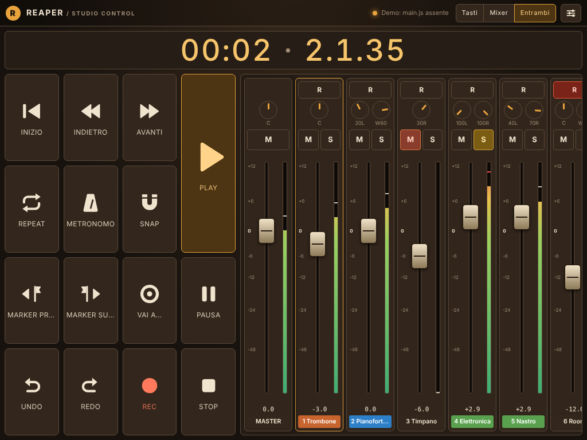
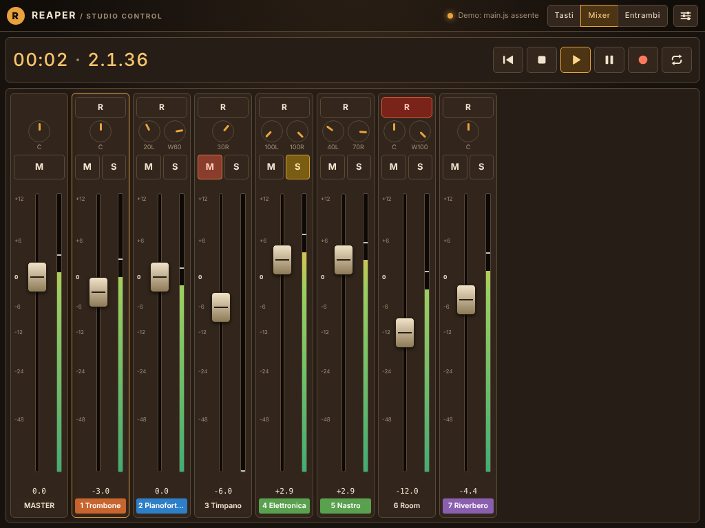
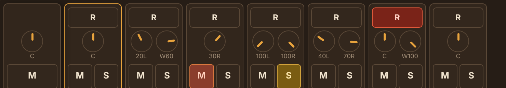
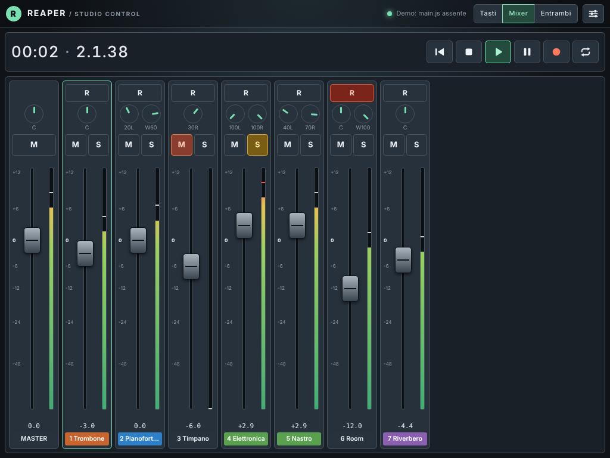
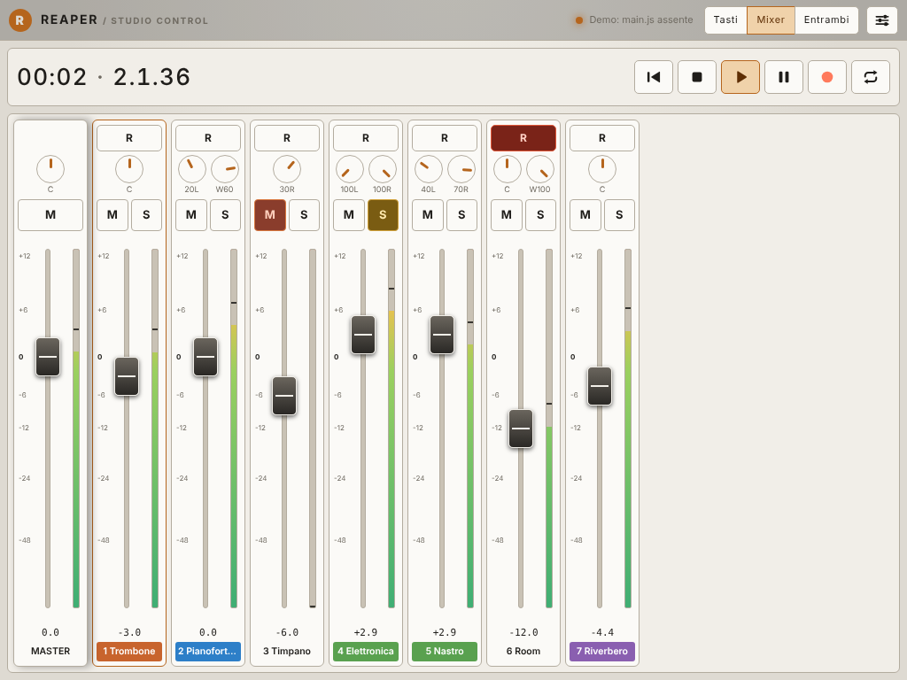

# REAPER Studio Control

A touch remote for [REAPER](https://www.reaper.fm/), built as a single HTML page. It runs on top of REAPER's own Web Control and gives a tablet or phone a transport keypad and a mixer with faders, mute, solo, record arm and pan.



The page was designed for use in the recording room: large buttons, a big position counter, a mixer that fits a 1024 × 768 screen, and no installation beyond copying one file. The screenshots in this document come from the built-in demo mode, which simulates a small project.

## Features

**Transport keypad**
- Play, pause, stop, record, go to start, bar back and forward, repeat, metronome, snap, undo, redo, previous and next marker, go to position.
- A large counter showing time and bars/beats (or only one of the two).
- Every key is configurable: choose the action, the order, the size, and the number of columns.
- Any REAPER action can be added by its Command ID, with your own label. Script IDs starting with an underscore work as well.
- Optional second tap before recording starts.


**Mixer**
- One strip per track, plus the master: fader with dB scale, peak meter, mute, solo, record arm, dB readout, track name in the track colour.
- Faders are drawn by the page, not by the browser, so they behave the same on iOS and Android and several can be moved with different fingers at once.
- Dragging is relative: touching a fader does not make it jump. A double tap resets it to 0 dB.
- Fader range of +12 dB or +6 dB, matching REAPER's fader law only approximately (see [Known limits](#known-limits)).
- Solo lights up for both normal solo and solo in place.
- Tracks hidden from the mixer in REAPER are hidden here too, unless you ask to see them.



**Pan, in the three REAPER pan modes**

Each strip reads the pan mode of its track and shows the matching controls:

| REAPER pan mode | Controls on the strip |
| --- | --- |
| Stereo balance / mono pan | one knob |
| Stereo pan | pan and width |
| Dual pan | left channel and right channel |

Knobs turn by vertical drag, as in REAPER. While a knob is moving, its value replaces the dB readout. A double tap returns it to its default: centre, width 100%, or fully left and fully right in dual pan.



**Layout and appearance**
- Three views: keypad, mixer, or both (side by side in landscape, stacked in portrait).
- Three themes: Tape Ambra (default), Graphite, Light.
- Narrow, medium and wide strips. Meters, pan, record arm, master and track colours can each be switched off.
- Settings are stored on the device. To move a configuration to another device, copy the text from the settings panel and paste it there.

<table>
<tr>
<td></td>
<td></td>
</tr>
<tr>
<td align="center">Graphite</td>
<td align="center">Light</td>
</tr>
</table>

<table>
<tr>
<td></td>
<td></td>
</tr>
<tr>
<td align="center">Settings panel</td>
<td align="center">Phone, portrait</td>
</tr>
</table>

## Requirements

- REAPER with the built-in Web browser interface (see below).
- A tablet, phone or computer on the same network as the machine running REAPER.
- A browser with CSS Grid support: Safari on iOS 10.3 or later (for example an iPad Air 1 updated to its last iOS), Chrome or any current browser on Android, and current desktop browsers.

No build step and no dependencies. The page is plain HTML, CSS and JavaScript (ES5), and it uses the `main.js` that REAPER already serves.

## Installation

1. In REAPER open **Options → Preferences → Control/OSC/web**, click **Add**, choose **Web browser interface** and set a port (8080 by default).
2. Copy `reaper-studio-control.html` into REAPER's web root folder, `reaper_www_root`, inside the REAPER resource path. Do not overwrite `index.html` or any other page that is already there.
3. In the same preferences window you can select this page as the default interface. Otherwise add the file name to the address.
4. On the tablet or phone open `http://<ip-of-the-computer>:8080/reaper-studio-control.html`.
5. Optional: on iOS use **Share → Add to Home Screen**, on Android **Add to Home screen** in the browser menu, to open the page without browser bars.

If you set a user name and password in REAPER, the browser will ask for them on first load.

## Using it

- The dot in the top bar is green while REAPER answers and turns off when no reply has arrived for three seconds.
- The gear button opens the settings. **Keys** lists every key of the keypad: change its action, make it large, move it up or down, delete it, or add a new one.
- To add a REAPER action that is not in the menu: in REAPER's action list right-click the action, choose *Copy selected action command ID*, then pick **Custom action…** for a key and paste the ID.
- **Go to…** accepts a time (`1:02.500`) or a bar position (`12.1.00`) and sends it to REAPER as typed.

## Demo mode

If the page is opened outside REAPER, so that `main.js` cannot be loaded, it starts in demo mode with eight simulated tracks. The transport, faders, mute, solo and pan respond, which is enough to try the layout and prepare a configuration on a computer. The top bar says so.

## How it talks to REAPER

The page sends commands and polls state through the functions of REAPER's web interface (`wwr_req`, `wwr_req_recur`). It polls the transport every 100 ms and the tracks every 200 ms with meters on, 500 ms otherwise, and it only asks for tracks when a view that needs them is on screen. Fader and pan moves are sent while dragging and closed with an undo point. The command and field names used here are those documented in the ReaTeam [web interface modding notes](https://github.com/ReaTeam/Doc/blob/master/web_interface_modding.md).

## Known limits

- **Early version.** The interface is tested in demo mode and in desktop Chromium at tablet and phone sizes. Behaviour that depends on REAPER's replies, in particular which tracks count as hidden, track colours, meters, the pan and width values in dual pan, and the undo points after a drag, still needs checking against real projects on real devices.
- The pan mode of a track can be read but not changed from the page, because the web interface has no command for it. Choose it in REAPER.
- The fader law is a close approximation of REAPER's, not an exact copy. Values read the same at 0 dB and at the ends, and differ slightly in between.
- No sends, FX, routing, or item and take editing. This is a transport and mixer remote.
- The interface language is currently Italian (Tasti, Mixer, Entrambi, Impostazioni and the labels of the keys).
- Browsers older than iOS 10.3 cannot show the keypad, which relies on CSS Grid.

## Regenerating the screenshots

The screenshots are produced from the demo mode by a script.

```sh
pip install playwright
python3 tools/screenshots.py
```

The script looks for Google Chrome at `/usr/bin/google-chrome`. Set `CHROME_PATH` to use another Chromium-based browser. Output goes to `docs/screenshots/`.

## Notes

REAPER is a product of Cockos Incorporated. This project is independent and is not affiliated with or endorsed by Cockos.
