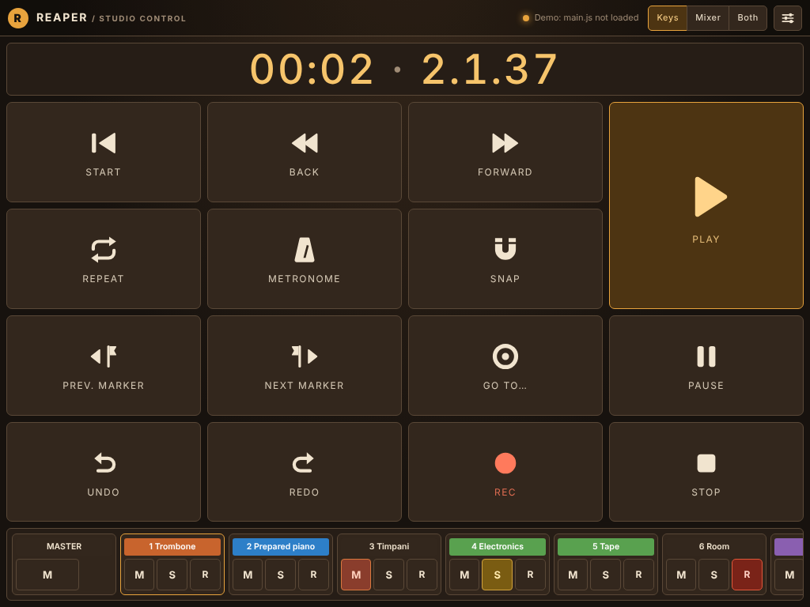
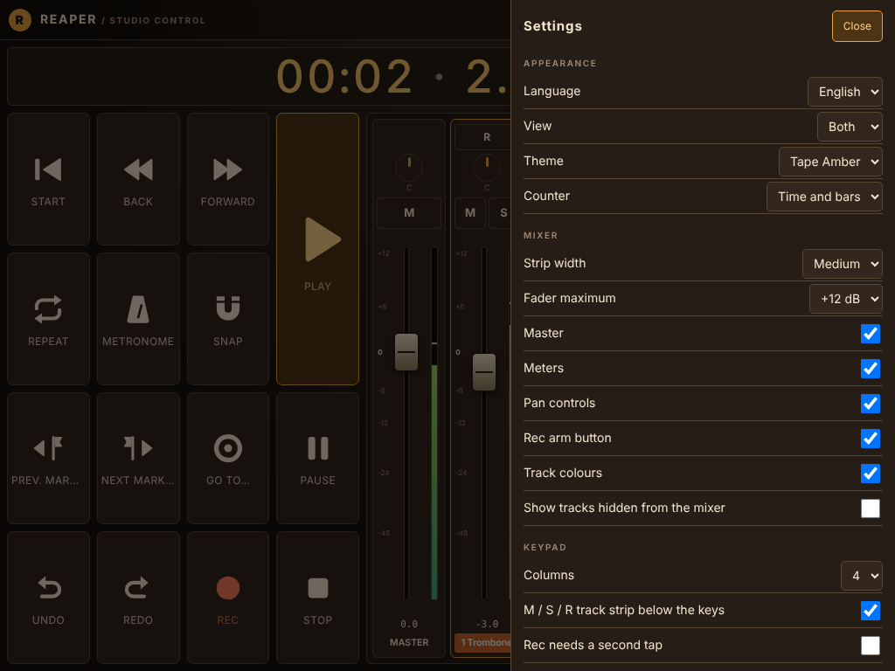
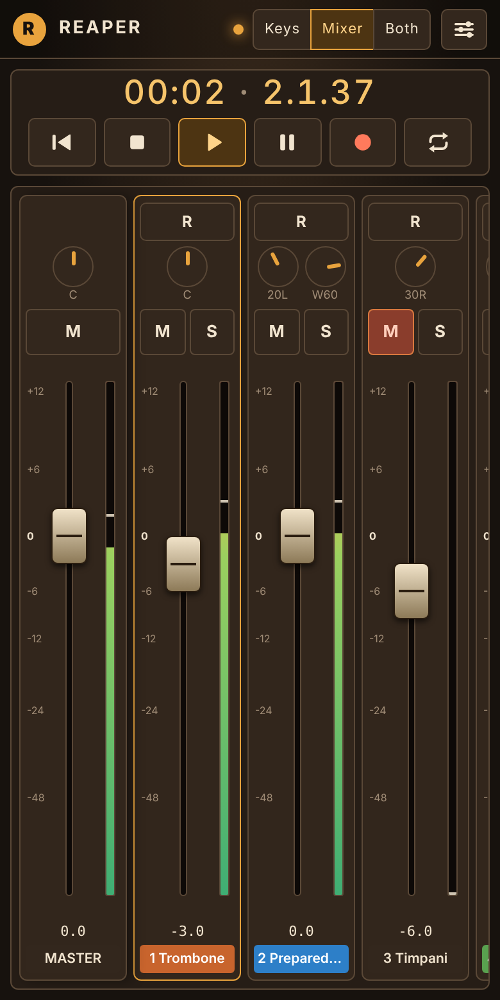
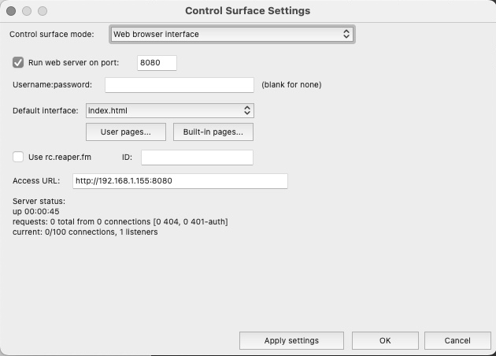

# REAPER Studio Control

A touch remote for [REAPER](https://www.reaper.fm/), built as a single HTML page. It runs on top of REAPER's own Web Control and gives a tablet or phone a transport keypad and a mixer with faders, mute, solo, record arm and pan.


The page was designed for use in the recording room: large buttons, a big position counter, a mixer that fits a 1024 × 768 screen, and no installation beyond copying one file. The screenshots in this document come from the built-in demo mode, which simulates a small project.

## Features

**Transport keypad**
- Play, pause, stop, record, go to start, bar back and forward, repeat, metronome, snap, undo, redo, previous and next marker, go to position.
- A large counter showing time and bars/beats (or only one of the two).
- Every key is configurable: choose the action, the order, the size, and the number of columns.
- Any REAPER action can be added by its Command ID, with your own label. Script IDs starting with an underscore work as well.
- Optional second tap before recording starts.



**Mixer**
- One strip per track, plus the master: fader with dB scale, peak meter, mute, solo, record arm, dB readout, track name in the track colour.
- Faders are drawn by the page, not by the browser, so they behave the same on iOS and Android and several can be moved with different fingers at once.
- Dragging is relative: touching a fader does not make it jump. A double tap resets it to 0 dB.
- Fader range of +12 dB or +6 dB, matching REAPER's fader law only approximately (see [Known limits](#known-limits)).
- Solo lights up for both normal solo and solo in place.
- Tracks hidden from the mixer in REAPER are hidden here too, unless you ask to see them.


**Pan, in the three REAPER pan modes**

Each strip reads the pan mode of its track and shows the matching controls:

| REAPER pan mode | Controls on the strip |
| --- | --- |
| Stereo balance / mono pan | one knob |
| Stereo pan | pan and width |
| Dual pan | left channel and right channel |

Knobs turn by vertical drag, as in REAPER. While a knob is moving, its value replaces the dB readout. A double tap returns it to its default: centre, width 100%, or fully left and fully right in dual pan.


**Layout and appearance**
- Three views: keypad, mixer, or both (side by side in landscape, stacked in portrait).
- Three themes: Tape Amber (default), Graphite, Light.
- English interface by default, Italian from the settings panel. The choice is stored on the device.
- Narrow, medium and wide strips. Meters, pan, record arm, master and track colours can each be switched off.
- Settings are stored on the device. To move a configuration to another device, copy the text from the settings panel and paste it there.

<table>
<tr>
<td></td>
<td></td>
</tr>
<tr>
<td align="center">Graphite</td>
<td align="center">Light</td>
</tr>
</table>

<table>
<tr>
<td></td>
<td></td>
</tr>
<tr>
<td align="center">Settings panel</td>
<td align="center">Phone, portrait</td>
</tr>
</table>

## Requirements

- REAPER with the built-in Web browser interface (see below).
- A tablet, phone or computer on the same network as the machine running REAPER.
- A browser with CSS Grid support: Safari on iOS 10.3 or later (for example an iPad Air 1 updated to its last iOS), Chrome or any current browser on Android, and current desktop browsers.

No build step and no dependencies. The page is plain HTML, CSS and JavaScript (ES5), and it uses the `main.js` that REAPER already serves.

## Installation

Installing takes two things: turning on REAPER's built-in web server, and copying this one file into the folder that the server serves. Nothing is compiled and nothing else is installed.

### 1. Turn on REAPER's web interface

1. Open REAPER's preferences (**Options → Preferences**, or `Cmd+,` on macOS and `Ctrl+P` on Windows) and select **Control/OSC/web**.
2. Click **Add** and, in **Control surface mode**, choose **Web browser interface**.
3. Leave **Run web server on port** ticked. The default port is 8080: any free port works.
4. Optional: set a user name and password in **Username:password**, written as `name:password`.
5. Note the **Access URL** at the bottom of the dialog. It holds the address of the computer on your network and the port, for example `http://192.168.1.50:8080`. You will type it on the tablet.
6. Click **OK** in both windows.



### 2. Copy the page into REAPER's web folder

REAPER serves its pages from a folder called `reaper_www_root`, inside the REAPER resource path.

1. In REAPER choose **Options → Show REAPER resource path in explorer/finder**.
2. Open the `reaper_www_root` folder. Its usual location:

   | System | Folder |
   | --- | --- |
   | macOS | `~/Library/Application Support/REAPER/reaper_www_root` |
   | Windows | `%APPDATA%\REAPER\reaper_www_root` |
   | Linux | `~/.config/REAPER/reaper_www_root` |

   In a portable installation the folder sits inside the REAPER folder itself.
3. Copy `reaper-studio-control.html` into it. Do not replace `index.html` or any other page already there: they are REAPER's own interfaces.

The page loads `main.js` from the same server, so there is nothing else to copy.

### 3. Open it on the tablet or phone

1. Connect the device to the same Wi-Fi network as the computer running REAPER.
2. In the browser type the Access URL followed by the file name, with `http://` at the start:

   ```
   http://192.168.1.50:8080/reaper-studio-control.html
   ```

   Replace the address and port with the ones shown in your Access URL.
3. Optional: to leave out the file name, choose `reaper-studio-control.html` in the **Default interface** menu of the same REAPER dialog. If it is not listed, reopen the dialog or restart REAPER. Then `http://192.168.1.50:8080` is enough.
4. Optional: to open the page without browser bars, use **Share → Add to Home Screen** on iOS, or **Add to Home screen** in the Chrome menu on Android.

### 4. Check that it works

- The dot at the top right is lit and the text reads **Connected to REAPER**.
- Press Play: the counter runs and the Play key lights up.
- **Demo: main.js not loaded** means the page was not served by REAPER: see below.
- **REAPER not responding** means no reply has arrived for three seconds.
- In REAPER's dialog the **Server status** lines count requests and failed requests (404), which helps to see whether the device reaches the computer at all.

### Troubleshooting

| What you see | Likely cause | What to do |
| --- | --- | --- |
| The browser says it cannot connect, while `http://localhost:8080` works on the computer | The device cannot reach the computer | Check that the device is on the same Wi-Fi (not mobile data, a guest network or a VPN). Allow incoming connections for REAPER in the computer's firewall. Look in the router for an option called client isolation or AP isolation and turn it off. |
| It worked yesterday and not today | The computer's address changed | Read the Access URL again in REAPER's dialog. A reserved address for the computer in the router avoids this. |
| The browser searches the web or shows a security warning | The address was typed without `http://` and the browser tried `https` | Type the whole address starting with `http://`. REAPER's server does not speak `https`. |
| The page shows **Demo: main.js not loaded** | The page was opened from a file or from an address that is not REAPER's server | Open it through the address in step 3. |
| An error page or a 404 in REAPER's server status | The file is not in `reaper_www_root`, or the name in the address differs | Check the folder and the spelling of the file name. |
| The browser asks for a user name and password | They are set in REAPER | Enter them as set in the dialog. |

### A note on security

The connection is plain HTTP and the password, if set, is not encrypted. Use the page on a network you trust and do not forward the port on your router to the internet.

## Using it

- The dot in the top bar is green while REAPER answers and turns off when no reply has arrived for three seconds.
- The gear button opens the settings. **Keys** lists every key of the keypad: change its action, make it large, move it up or down, delete it, or add a new one.
- To add a REAPER action that is not in the menu: in REAPER's action list right-click the action, choose *Copy selected action command ID*, then pick **Custom action…** for a key and paste the ID.
- **Go to…** accepts a time (`1:02.500`) or a bar position (`12.1.00`) and sends it to REAPER as typed.

## Demo mode

If the page is opened outside REAPER, so that `main.js` cannot be loaded, it starts in demo mode with eight simulated tracks. The transport, faders, mute, solo and pan respond, which is enough to try the layout and prepare a configuration on a computer. The top bar says so.

## How it talks to REAPER

The page sends commands and polls state through the functions of REAPER's web interface (`wwr_req`, `wwr_req_recur`). It polls the transport every 100 ms and the tracks every 200 ms with meters on, 500 ms otherwise, and it only asks for tracks when a view that needs them is on screen. Volume, pan and width go through REAPER's control surface commands while dragging. For pan and width REAPER reads a value that starts with `+` or `-` as a relative change, so negative values are sent as the difference from the last known value, and values from zero upwards are sent as absolute. The command and field names used here are those documented in the ReaTeam [web interface modding notes](https://github.com/ReaTeam/Doc/blob/master/web_interface_modding.md).

## Known limits

- **Early version.** The interface is tested in demo mode and in desktop Chromium at tablet and phone sizes. Behaviour that depends on REAPER's replies, in particular which tracks count as hidden, track colours, meters, and the pan mode numbers and the width and dual pan values that REAPER reports, still needs checking against real projects on real devices.
- The pan mode of a track can be read but not changed from the page, because the web interface has no command for it. Choose it in REAPER.
- The fader law is a close approximation of REAPER's, not an exact copy. Values read the same at 0 dB and at the ends, and differ slightly in between.
- No sends, FX, routing, or item and take editing. This is a transport and mixer remote.
- Only English and Italian are available. Adding a language means adding one more entry to each line of the `STR` table (and to `IT`/`ITT` for the key labels) in the HTML file.
- Browsers older than iOS 10.3 cannot show the keypad, which relies on CSS Grid.

## Development

The page is a single file with no build step. Two scripts in `tools/` use Playwright and a Chromium-based browser (they look for `/usr/bin/google-chrome`: set `CHROME_PATH` to use another).

```sh
pip install playwright
python3 tools/screenshots.py   # regenerates docs/screenshots/ from the demo mode
python3 tools/test_demo.py     # drives the demo with touch events and checks fader, pan and width
```

`tools/test_demo.py` relies on the demo mode imitating REAPER's rule for relative values, which is how it catches pan and width commands that REAPER would misread. The installation screenshot, `reaper-web-interface-setup.png`, is a capture of REAPER itself and is not produced by the script.

## Notes

REAPER is a product of Cockos Incorporated. This project is independent and is not affiliated with or endorsed by Cockos.
